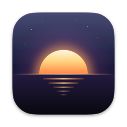
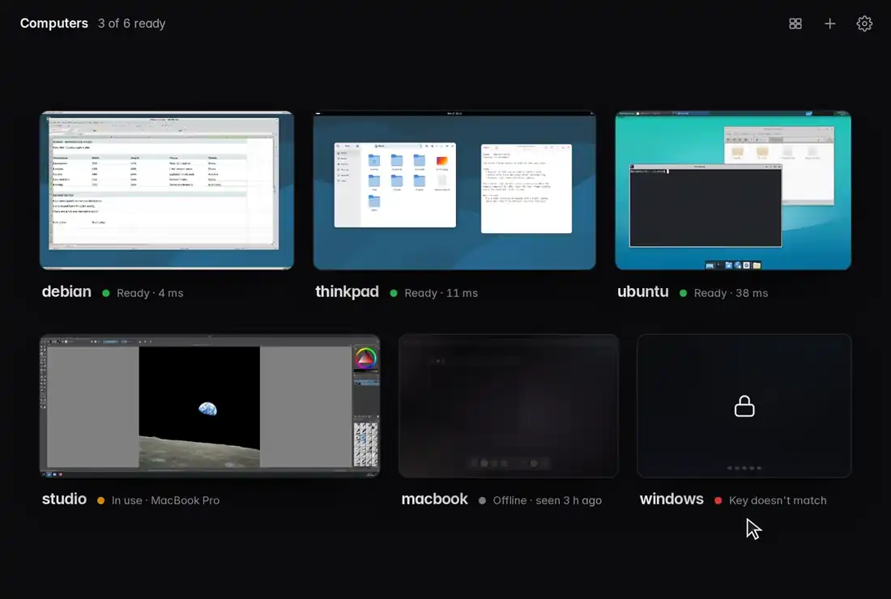

<p align="center"></p>

<h1 align="center">Sunna</h1>

<p align="center">Your other computers, on the device in your hands.<br>A remote desktop for your own machines, over your own network.</p>

<p align="center"><a href="https://sunna.sunnydx.dev/">Website</a> · <a href="https://sunna.sunnydx.dev/guides/">Guides</a> · <a href="docs/troubleshooting.md">Troubleshooting</a></p>

<p align="center"></p>

Sunna shows another computer's screen, plays its sound, and sends your keyboard, mouse, touch and clipboard back. Your devices talk to each other directly. There are no accounts and nothing passes through a server of ours.

## What it does

- **Opens a computer like opening a window.** The app lists your computers with the last picture of each. Click one and you're in it, full screen.
- **Typing that keeps up.** Video takes time to encode, most of all without a GPU. Small changes, like the letter you just typed, go ahead of the video as exact image tiles. On a host encoding on its CPU, a typed letter reached the viewer in about 2 ms where a video frame took about 35 ([the fast lane](docs/using.md#the-fast-lane)).
- **Checks it's really your computer.** A link or QR code carries the computer's identity. The app checks it before it sends anything, proves it knows the key without sending the key, and refuses a computer whose identity has changed ([Security](docs/security.md)).
- **Share a computer with a switch.** On Linux, Settings → Share this computer starts sharing and keeps it on after you close the window. The same switch is written for the Mac and waiting for its first test on one.
- **Reach it after a restart.** A Linux host can run for the whole machine, so after a reboot you get the login screen and sign in from where you are. Experimental; proven on LightDM and SDDM in test machines.
- **Updates itself.** Signed releases, a switch between versions that can't half-happen, and a return to the previous version if a new one doesn't start. There are downloads for Linux on x86-64 (a `.deb`, an `.rpm` and an install command), for Android, and for a Mac (a `.dmg`, which doesn't update itself yet).

## What runs where

| | Mac | Linux | Android | Windows |
|---|---|---|---|---|
| **Reach other computers** (the app) | yes ([guide](docs/app-mac.md)) | yes ([guide](docs/app-linux.md)) | yes ([guide](docs/app-android.md)) | planned |
| **Be reached** (the host) | yes ([guide](docs/host-mac.md)) | yes: X11, GNOME on Wayland, or a server with no screen ([guide](docs/host-linux.md)) | no | experimental |

**Status: early.** Mac → Mac and Mac → Linux are in daily use. The Linux and Android apps are newer. Sharing a GNOME desktop on Wayland is tested on GNOME 46, 49 and 50, not yet on a real laptop. The newest parts (the sharing switch, the Mac host in the menu bar, the whole-machine Linux host, and self-update) have been tested in containers and virtual machines on Linux, and not yet on a real Mac. [What has and hasn't been verified](docs/update-verification.md).

## Get started

There are downloads for a Mac (a `.dmg`), for Linux on x86-64 and for Android. On ARM Linux you build Sunna from source for now. The [website](https://sunna.sunnydx.dev/#downloads) lays out the steps for each device.

1. **Put both devices on [Tailscale](https://tailscale.com)** (free for personal use). Sunna works on any network you trust, but Tailscale makes your computers reachable from anywhere and keeps everyone else out. Keep a host off the public internet.
2. **Share a computer**: [Linux](docs/host-linux.md) or [Mac](docs/host-mac.md). On a Mac, the app from step 3 does the sharing. On x86-64 Linux, install the host:

   | | |
   |---|---|
   | Ubuntu, Debian | `curl -fLO https://sunna.sunnydx.dev/download/sunna-host.deb && sudo apt install ./sunna-host.deb` |
   | Fedora | `sudo dnf install https://sunna.sunnydx.dev/download/sunna-host.rpm` |
   | Any other Linux, or without root | the command below |

   ```sh
   curl -fsSL --proto '=https' --proto-redir '=https' https://sunna.sunnydx.dev/install.sh -o sunna-install.sh &&
     test -s sunna-install.sh && sh sunna-install.sh host
   ```
   Then `sunna-host setup` starts sharing. You get a **link** and a **QR code**:
   ```
   sunna://100.101.102.103?key=7f3a…&id=Qm9v…
   ```
   The link contains the key that grants access to that computer. Treat it like a password.
3. **Install the app** on the device you'll use: [Mac](docs/app-mac.md), [Linux](docs/app-linux.md) or [Android](docs/app-android.md).
   - Mac: the `.dmg` for [Apple silicon](https://sunna.sunnydx.dev/download/Sunna-apple-silicon.dmg) or [Intel](https://sunna.sunnydx.dev/download/Sunna-intel.dmg). Sunna isn't signed with a paid Apple certificate, so the first time you open it macOS stops it: choose **Open Anyway** in System Settings → Privacy & Security.
   - Linux on x86-64: [sunna.deb](https://sunna.sunnydx.dev/download/sunna.deb), [sunna.rpm](https://sunna.sunnydx.dev/download/sunna.rpm), or the command from step 2 with `app` in place of `host`.
   - Android: open [sunna.apk](https://sunna.sunnydx.dev/download/sunna.apk) on the phone.
4. **Add the computer** in the app: paste the link, or scan the QR code with your phone. It shows **Ready** when it can be reached. Click or tap it to connect.

## Updating

How a copy updates depends on how it was installed.

- **From the `.deb` or `.rpm`:** with the rest of your system. The package adds Sunna's package source, `sunna.sunnydx.dev`, so `apt upgrade` or `dnf upgrade` brings new versions. A host that is sharing switches to the new version at `sunna-host restart`.
- **From the install command:** by itself. A host checks for a release once a day and tells you, or installs it by itself if you turned that on; it never restarts under someone who is connected. The app shows which of your computers are out of date and can tell each one to update. From a terminal:

  ```sh
  sunna-host update --check      # is there a newer release?
  sunna-host update --yes        # install it
  sunna-host update --rollback   # go back to the version before
  ```
- **On Android:** Settings → Check for updates downloads the new APK, and Android asks you to confirm it.
- **From the Mac `.dmg`:** download the new `.dmg` and replace the app. That copy doesn't update itself.
- **Built from source:** `git pull`, then run the same install script again.

Every release is signed. The install command and the Android app check Sunna's release signature themselves; `apt` and `dnf` check the package source's signature ([how this was tested](docs/update-verification.md)).

## Guides

| | |
|---|---|
| [Get started](docs/get-started.md) | the short version of everything below |
| [Share a Linux computer](docs/host-linux.md) | your desktop or laptop (X11, or GNOME on Wayland), a server with no screen, or the whole machine including its login screen |
| [Share a Mac](docs/host-mac.md) | the switch in Settings and the menu bar item |
| [The app on a Mac](docs/app-mac.md) · [on Linux](docs/app-linux.md) · [on Android](docs/app-android.md) | install it, and what's different on each |
| [Using Sunna](docs/using.md) | adding computers, connecting, the session menu, shortcuts |
| [Troubleshooting](docs/troubleshooting.md) | when something doesn't connect or look right |
| [Security and privacy](docs/security.md) | keys, identity, encryption, what's logged |
| [Building from source](docs/building.md) | for developers: the workspace, layout and tests |

## License

No license has been chosen yet; until one is, all rights are reserved.
