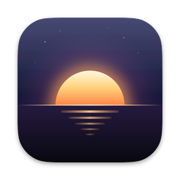
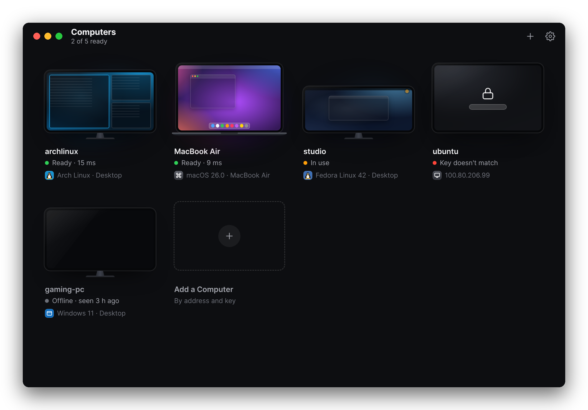

<p align="center"></p>

<h1 align="center">Sunna</h1>

<p align="center">Use your other computers from wherever you are. A fast remote desktop for Mac, Linux and Android, over your own network.</p>

<p align="center"><a href="https://34.131.68.196">Website</a> · <a href="#get-started">Get started</a> · <a href="docs/troubleshooting.md">Troubleshooting</a></p>

<p align="center"></p>

Sunna shows another computer's screen, plays its sound, and sends your keyboard, mouse, touch and clipboard back. There are no accounts and no cloud: your devices talk to each other directly, ideally over [Tailscale](https://tailscale.com).

## How it works

There are two parts:

- **The host** runs on the computer you want to reach (your desktop at home, a laptop, a server). It shares that computer's screen.
- **The app** runs on the device you're sitting at. It lists your computers and opens a session with one of them.

You install the host once on each computer you want to reach, and the app on each device you use them from.

| | Mac | Linux | Android | Windows |
|---|---|---|---|---|
| **Host** (be reached) | yes, from a Terminal window ([guide](docs/host-mac.md)) | yes, as a service ([guide](docs/host-linux.md)) | no | not yet |
| **App** (reach others) | yes ([guide](docs/app-mac.md)) | yes ([guide](docs/app-linux.md)) | yes, built from source ([guide](docs/app-android.md)) | not yet |

**Status: early.** Mac → Mac and Mac → Linux are in daily use. The Linux and Android apps are newer, and sharing a GNOME desktop on Wayland is newest (tested on GNOME 46, 49 and 50, not yet on a real laptop). There are no prebuilt downloads yet: everything is built from this repository.

## Get started

1. **Put both devices on Tailscale** (free for personal use). Sunna works on any network, but Tailscale makes your computers reachable from anywhere and keeps everyone else out. See [Security](docs/security.md) for why.
2. **Share a computer.** On Linux:
   ```sh
   git clone https://github.com/SunnyXdm/sunna.git && cd sunna
   scripts/install-host-linux.sh
   ```
   On a Mac, see [Share a Mac](docs/host-mac.md). When the host starts, it prints a **link** and a **QR code**:
   ```
     Address   100.101.102.103
     Key       7f3a…
     sunna://100.101.102.103?key=7f3a…
   ```
3. **Install the app** on the device you'll use: [Mac](docs/app-mac.md), [Linux](docs/app-linux.md) or [Android](docs/app-android.md).
4. **Add the computer** in the app: paste the link (or scan the QR code with your phone). It lights up when it can be reached. Tap or click it to connect.

## Guides

| | |
|---|---|
| [Share a Linux computer](docs/host-linux.md) | your desktop or laptop (X11, or GNOME on Wayland), or a server with no screen |
| [Share a Mac](docs/host-mac.md) | run the host from a Terminal window |
| [The app on a Mac](docs/app-mac.md) · [on Linux](docs/app-linux.md) · [on Android](docs/app-android.md) | install it, and what's different on each |
| [Using Sunna](docs/using.md) | adding computers, connecting, the session menu, shortcuts |
| [Troubleshooting](docs/troubleshooting.md) | when something doesn't connect or look right |
| [Security and privacy](docs/security.md) | keys, encryption, what's logged |
| [Building from source](docs/building.md) | for developers: the workspace, layout and tests |

## License

No license has been chosen yet; until one is, all rights are reserved.
