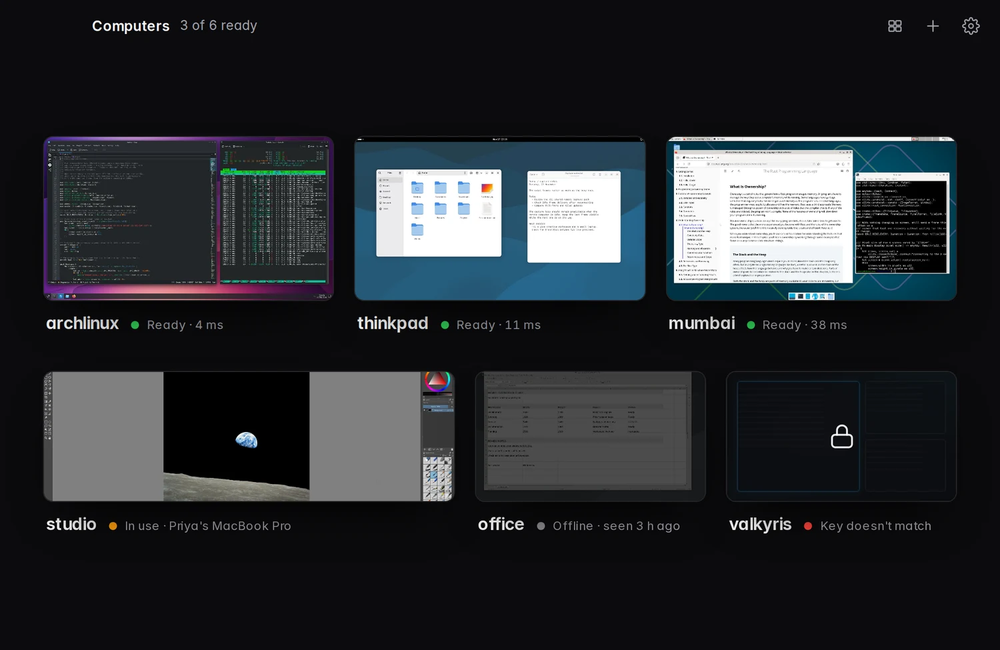

# Using Sunna

How to add computers, connect, and get around in a session. This page describes the Mac and Linux app; for phones and tablets see [the Android app](app-android.md).

[← Back to the README](../README.md)

## Share this computer from the Linux app

Open **Settings → Share this computer** at the desktop you want to reach.
Sunna installs the signed host if needed and starts it with your graphical
session. On GNOME or KDE Wayland, approve the desktop’s permission request.
Settings shows the address and offers **Copy** and **Show QR Code**. The link
includes the connection key. Share it privately. See [Network security](security.md).

Closing Sunna leaves sharing on. Turn the switch off to stop the host and
its automatic start. The switch also controls a user host configured with
`sunna-host setup`. A system host that shares the login screen is managed
by an administrator.

## Your computers

- **Add a computer** with **+** (⌘N): paste its `sunna://` link, or type its address (an IP, a name, or `name.tailnet.ts.net`) and key. The preview lights up as soon as the computer answers. **Find on Tailscale** lists the computers on your tailnet that are sharing.
- **View** chooses **Devices**, **Wall**, **Space**, **Type**, or **Gallery**. Use the view menu beside **+**, or Settings → View; the choice is saved on this device. Gallery is the default. Arrow keys select computers; in Devices, clicking a neighbour selects it first.
- **Connect** by clicking a computer marked **Ready**. The session opens in its own window, full screen unless you change that in Settings.
- **Right-click** a computer (or its ••• button) to edit it, copy its address, show its QR code, or remove it.
- **Kind** in Edit lets you choose Laptop, Desktop, Mini PC, Server, or Virtual machine. Automatic uses what the host reports. This override stays on this device.
- **Settings** (⌘,): full screen or window, sound, the stats bar and the ••• button, and this computer's own key and link.

After a session, a computer's screen here shows what it last looked like. The picture is taken once, as you leave the session (nothing is saved while it runs), is at most 1280 pixels wide, and stays on this device in `~/.sunna/pictures/`. Settings → **Screen pictures** changes what's kept: **Blurred** keeps only the screen's colours (about 32 pixels across, nothing readable), **Off** keeps nothing. Switching to Off or Blurred deletes the pictures kept before, and removing a computer deletes its picture. Computers without a picture show an OS drawing; offline pictures are dimmed.

The app only checks the computers you've added, every few seconds while its window is open. It never scans your network on its own.

| In the Computers window | |
|---|---|
| ⌘N | add a computer |
| ⌘1 … ⌘5 | Devices, Wall, Space, Type, Gallery |
| ⌘⌥1 … ⌘⌥9 | connect to the first nine computers |
| Arrow keys, Enter | select a computer, connect or show its state |
| Shift+F10 | open the selected computer’s menu |
| ⌘E, ⌫ | edit or remove the selected computer |
| ⌘R | check all computers again |
| ⌘, | settings |
| Esc | stop connecting |

On Linux, use Ctrl where the Mac uses ⌘.

## In a session

Open the session menu with the **•••** button at the top left, or **⌃⌥M**:

| | |
|---|---|
| Keyboard | send ⌘ shortcuts to the other computer, and **Send Keys**: its own system shortcuts (on a Mac: Switch Apps, Spotlight, Mission Control, Force Quit, Lock Screen; on Linux: Switch Windows, App Launcher, Terminal, Lock Screen, Log Out) |
| Clipboard | share it or not (text and images, both ways); **Type Clipboard Text** types it key by key, for login screens that won't take a paste |
| Video | codec, resolution, frame rate, bitrate limit, and the fast lane |
| Also | full screen or window, **Play Sound**, the stats bar, and Disconnect |

| Shortcut | |
|---|---|
| ⌃⌥M | session menu |
| ⌃⌥G | give ⌘Tab and other system shortcuts back to this Mac, or send them to the other computer again |
| ⌃⌥F | full screen or window |
| ⌃⌥S | stats bar: latency, frame rate, bitrate, codec |
| ⌃⌥Q | disconnect |

On Linux, use Ctrl+Alt for ⌃⌥.

## One viewer at a time

A computer takes one viewer at a time. While someone else is connected, the app shows it as **In use**, and by whom. Your own sessions never block you: disconnecting frees the computer at once, and if one of yours was left behind (a crash, a lost network), connecting again takes it over.

## The fast lane

Small changes, like a typed letter, are sent as exact tiles on their own, ahead of the video. On a host that encodes video on the CPU, typed text then shows up in about 2 ms plus the network, instead of the 35 ms or so a video frame takes. It's on by default for those hosts; switch it in the session menu under Video.

## Updates

Open **Settings → Updates** to see this app's version, check for a signed
release, or restart after a download is ready. The **Updates** menu in the Computers toolbar also offers a restart when a release is staged. It stays out of the way while you connect.
An open viewer must be disconnected before restarting.

**Automatically** applies a staged update the next time you open the app. **Ask first** downloads it and waits for you to choose **Restart to update**. **Never** leaves checks to you. A source checkout or
system package cannot update itself here; Settings explains how to install a
signed download or use the package manager.

The **Updates** toolbar menu lists computers with a release available. You can also open a computer’s
**•••** menu and choose **Update this computer…**. After you confirm, that
computer downloads and verifies the signed release itself. Its host restarts
when nobody is connected. The app shows **Updating…**, then the new version
once the computer answers again. A rejected request or failed release shows
its reason; a slow or unreachable host stays unconfirmed rather than being
reported as updated.

**Edit → Host updates** sets Automatic, Tell me, or Off on a host that supports
remote updates. This choice takes effect immediately and affects everyone
using that host. Older hosts and unmanaged installations need a signed
installation once by hand. The update sheet shows the Linux install command
from [Setting up a Linux computer](host-linux.md).

A new sharing link and its QR code include the computer's identity. Add it with that link to verify the first connection. If you enter an address and key separately, Sunna remembers the identity after the computer proves it knows the key. Edit shows the first twelve characters so you can compare them with the owner.

To replace the host identity deliberately, run `sunna-host new-identity` on Linux. On a Mac, stop sharing, run `sunna host new-identity`, then start sharing again. Share the new link with each viewer. Rotating the sharing key alone keeps the host identity.

While **Allow this older computer** is on, even background checks send the full sharing key to whoever answers as an older host. A legacy session displays **Not fully verified** with statistics on or off.
