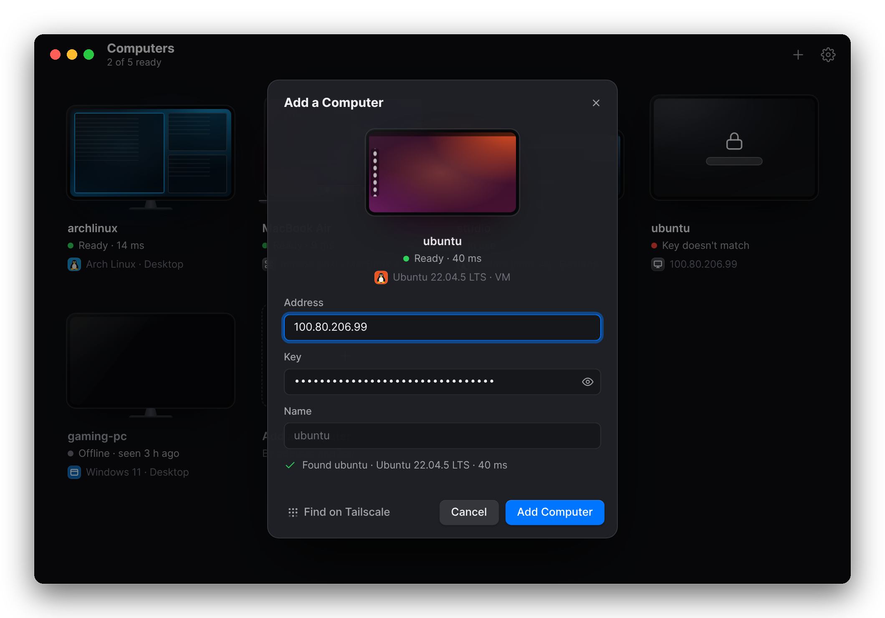

# Using Sunna

How to add computers, connect, and get around in a session. This page describes the Mac and Linux app; for phones and tablets see [the Android app](app-android.md).

[← Back to the README](../README.md)

## Your computers

- **Add a computer** with **+** (⌘N): paste its `sunna://` link, or type its address (an IP, a name, or `name.tailnet.ts.net`) and key. The preview lights up as soon as the computer answers. **Find on Tailscale** lists the computers on your tailnet that are sharing.
- **Connect** by clicking a computer whose screen is lit. The session opens in its own window, full screen unless you change that in Settings.
- **Right-click** a computer (or its ••• button) to edit it, copy its address, show its QR code, or remove it.
- **Settings** (⌘,): full screen or window, sound, the stats bar and the ••• button, and this computer's own key and link.

The app only checks the computers you've added, every few seconds while its window is open. It never scans your network on its own.

| In the Computers window | |
|---|---|
| ⌘N | add a computer |
| ⌘1 … ⌘9 | connect to the first nine computers |
| ⌘E, ⌫ | edit or remove the selected computer |
| ⌘R | check all computers again |
| ⌘, | settings |
| Esc | stop connecting |

On Linux, use Ctrl where the Mac uses ⌘.

## In a session

Open the session menu with the **•••** button at the top left, or **⌃⌥M**:

| | |
|---|---|
| Keyboard | send ⌘ shortcuts to the other computer, and **Send Keys**: its own system shortcuts (on a Mac: Switch Apps, Spotlight, Mission Control, Force Quit, Lock Screen; on Linux: Switch Windows, App Launcher, Terminal, Lock Screen, Log Out) |
| Clipboard | share it or not (text and images, both ways); **Type Clipboard Text** types it key by key, for login screens that won't take a paste |
| Video | codec, resolution, frame rate, bitrate limit, and the fast lane |
| Also | full screen or window, **Play Sound**, the stats bar, and Disconnect |

| Shortcut | |
|---|---|
| ⌃⌥M | session menu |
| ⌃⌥G | give ⌘Tab and other system shortcuts back to this Mac, or send them to the other computer again |
| ⌃⌥F | full screen or window |
| ⌃⌥S | stats bar: latency, frame rate, bitrate, codec |
| ⌃⌥Q | disconnect |

On Linux, use Ctrl+Alt for ⌃⌥.

## One viewer at a time

A computer takes one viewer at a time. While someone else is connected, the app shows it as **In use**, and by whom. Your own sessions never block you: disconnecting frees the computer at once, and if one of yours was left behind (a crash, a lost network), connecting again takes it over.

## The fast lane

Small changes, like a typed letter, are sent as exact tiles on their own, ahead of the video. On a host that encodes video on the CPU, typed text then shows up in about 2 ms plus the network, instead of the 35 ms or so a video frame takes. It's on by default for those hosts; switch it in the session menu under Video.
